# Mechanism examples (A1–R5)

One persistent example for each of the 17 distinct mechanisms in `mechanism_table.tex`, using the exact `rxn_map` recipe assigned to that mechanism. Every registry entry carries a `"mechanism"` field (A1–R5). Each example uses a known practical polymer; the trace panel shows the mechanism walkthrough. If no practical polymer is identified for a mechanism, the entry is marked `needs candidate` for follow-up.

**Reading the SMARTS fields.** `reaction SMARTS` is the exact registry key used to select the polymer family. For coupling and ring-opening entries it is a topology key, not necessarily the template that is executed. The `Compiled recipe` block below each example is the SMARTS the driver actually compiles, including atom maps and chemoselectivity guards.

Regenerate with:

```sh
python benchmarks/extract_extension_traces.py --mode mechanisms
```

| ID | Family | Recipe / topology | Practical polymer | Status | Monomers |
| --- | --- | --- | --- | --- | --- |
| A1 | Addition | single non-ring vinyl (CH2 attachment; H caps) | Polypropylene (PP) | commercial | `C=CC` |
| A2 | Addition | single cyclic vinyl (H caps) | Vinyl-addition poly(norbornene) | known/specialty | `C1CC2C=CC1C2` |
| A3 | Addition | acyclic + cyclic pair (CH2 attachment; H caps) | Ethylene–norbornene cyclic olefin copolymer (COC) | commercial | `C=C` + `C1CC2C=CC1C2` |
| A4 | Addition | two non-ring vinyl pair (CH2 attachment; H caps) | Ethylene–propylene rubber (EPR) | commercial | `C=C` + `C=CC` |
| C1 | Coupling | AA+BB; HA; acid/acyl halide or methyl-ester transesterification | Poly(ethylene terephthalate) (PET) | commercial | `O=C(O)c1ccc(C(=O)O)cc1` + `OCCO` |
| C2 | Coupling | AA+BB; HA AA+BB; HA AB (amidine OK; amide/SO2/P=O blocked) | Nylon-6,6 | commercial | `O=C(O)CCCCC(=O)O` + `NCCCCCCN` |
| C3 | Coupling | AA+BB (NCO + guarded OH/SH) | Polyurethane (HDI + 1,4-butanediol) | commercial | `O=C=NCCCCCCN=C=O` + `OCCCCO` |
| C4 | Coupling | AA+BB (cyclic anhydride + diamine; 5-/6-membered only) | Kapton-type polyimide (PMDA + ODA) | commercial | `O=C1OC(=O)c2cc3c(=O)oc(=O)c3cc12` + `Nc1ccc(Oc2ccc(N)cc2)cc1` |
| C5 | Coupling | AA+BB (epoxide + NCO; 4 regio tiers) | Polyoxazolidone (BADGE + MDI) | known/specialty | `CC(C)(c1ccc(OCC2CO2)cc1)c1ccc(OCC2CO2)cc1` + `O=C=Nc1ccc(Cc2ccc(N=C=O)cc2)cc1` |
| C6 | Coupling | AB (diol + phosgene) | Bisphenol A polycarbonate (BPA-PC) | commercial | `CC(C)(c1ccc(O)cc1)c1ccc(O)cc1` |
| C7 | Coupling | PEEK; PES; PAEN (ketone/sulfone/nitrile; same-ring or phenyl-spaced; F before Cl/Br/I) | Poly(ether ether ketone) (PEEK) | commercial | `O=C(c1ccc(F)cc1)c1ccc(F)cc1` + `Oc1ccc(O)cc1` |
| C8 | Coupling | AB (ortho-blocked phenol) | Poly(2,6-dimethyl-1,4-phenylene oxide) (PPO) | commercial | `Cc1cccc(C)c1O` |
| R1 | Ring-opening | lactone ROP; water init.; carbamic-acid end allowed | Polycaprolactone (PCL) | commercial | `O=C1CCCCCO1` |
| R2 | Ring-opening | lactam ROP; water init.; amidine OK, amide/SO2/P=O blocked | Nylon-6 | commercial | `O=C1CCCCCN1` |
| R3 | Ring-opening | ROCOP (5-/6-membered anhydride, C/N/O/S backbone + epoxide; water init.) | Poly(ethylene succinate) (PES) | known | `O=C1CCC(=O)O1` + `C1CO1` |
| R4 | Ring-opening | epoxide ROP (direct; 4 regio tiers) | Poly(ethylene oxide) (PEO) | commercial | `C1CO1` |
| R5 | Ring-opening | ROMP; cuts C=C; joins via C=C | Poly(norbornene) (PNB, ROMP) | commercial | `C1CC2C=CC1C2` |

The overview panel collects the representative structure from every mechanism:

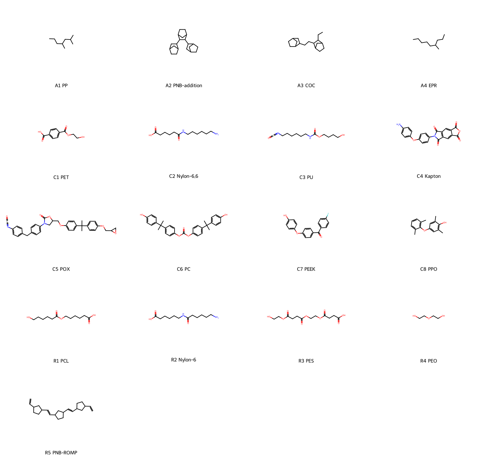

## A1 — Polypropylene (PP)

**Family:** Addition  
**Recipe / topology:** single non-ring vinyl (CH2 attachment; H caps)

| field | value |
| --- | --- |
| mechanism | `A1` |
| family | Addition |
| reaction SMARTS | `[C&X3;H2:1]=;!@[C&X3;H2,H1,H0:2]>>*-[C:1][C:2]-*` |
| registry type | `addition` |
| polymer class | `polyolefin` |
| practical polymer | Polypropylene (PP) |
| status | commercial |
| monomer(s) | `C=CC` |
| residues / propagation steps | 2 |
| generated product | `CCCC(C)CC(C)C` |

Commodity polyolefin; each propagation inserts one propene unit, and termination leaves the hydrogen caps.

**Compiled recipe (what the driver runs):**

- `init_smarts`: `[C&X3;H2:1]=;!@[C&X3;H2,H1,H0:2]>>[C:1][C:2]-*`
- `prop_smarts`: `[C:0][C&X4:1]-*.[C&X3;H2:2]=;!@[C&X3;H2,H1,H0:3]>>[C:0][C:1][C:2][C:3]-*`
- `term_smarts`: `[C:0][C:1]-*>>[C:0][C:1]`

**All registry keys assigned to A1:**

- `[C&X3;H2,H1,H0:1]=[C;H2,H1,H0:2]>>*-[C:1][C:2]-*`
- `[C&X3;H2:1]=;!@[C&X3;H2,H1,H0:2]>>*-[C:1][C:2]-*`

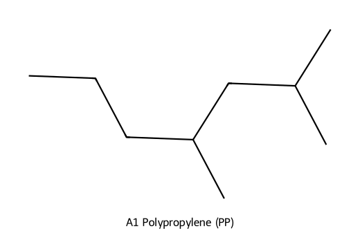

**Mechanism trace:**

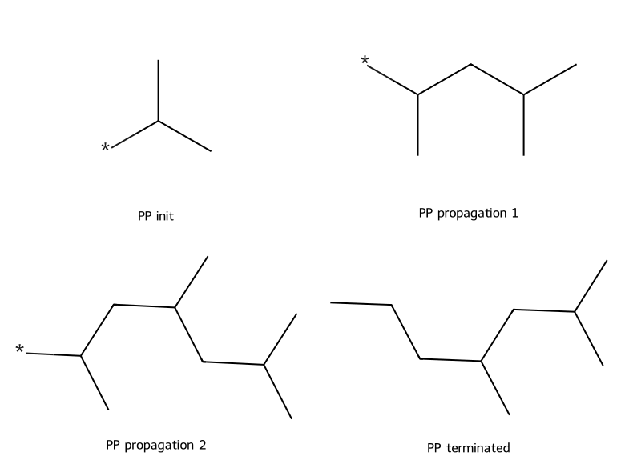

| step | SMILES |
| --- | --- |
| init | `*C(C)C` |
| propagation 1 | `*C(C)CC(C)C` |
| propagation 2 | `*C(C)CC(C)CC(C)C` |
| terminated | `CCCC(C)CC(C)C` |

## A2 — Vinyl-addition poly(norbornene)

**Family:** Addition  
**Recipe / topology:** single cyclic vinyl (H caps)

| field | value |
| --- | --- |
| mechanism | `A2` |
| family | Addition |
| reaction SMARTS | `[C&X3&R:1]=[C&X3&R:2]>>*-[C&X4&R:1][C&X4&R:2]-*` |
| registry type | `addition` |
| polymer class | `polyolefin` |
| practical polymer | Vinyl-addition poly(norbornene) |
| status | known/specialty |
| monomer(s) | `C1CC2C=CC1C2` |
| residues / propagation steps | 2 |
| generated product | `C1CC2CC1CC2C1C2CCC(C2)C1C1CC2CCC1C2` |

Vinyl-addition polymerisation retains the norbornane ring, giving the saturated-backbone cyclic olefin polymer; this is distinct from the ROMP product in R5. The bridged ring in the images is norbornane, not cyclopentane.

**Compiled recipe (what the driver runs):**

- `init_smarts`: `[C&X3&R:1]=[C&X3&R:2]>>[C&X4&R:1][C&X4&R:2]-*`
- `prop_smarts`: `[C:0][C&X4:1]-*.[C&X3&R:2]=[C&X3&R:3]>>[C:0][C:1][C&X4&R:2][C&X4&R:3]-*`
- `term_smarts`: `[C:0][C:1]-*>>[C:0][C:1]`

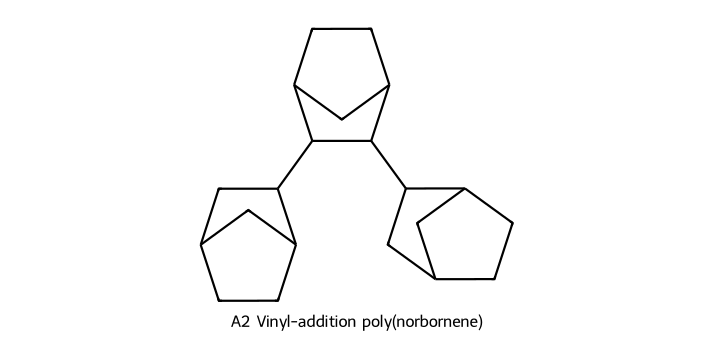

**Mechanism trace:**

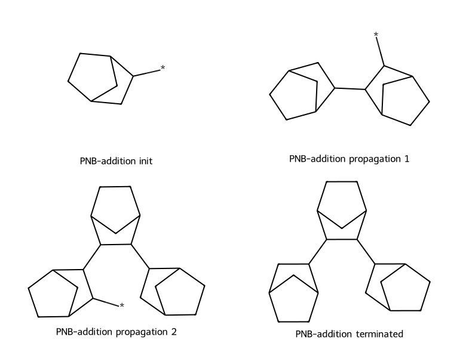

| step | SMILES |
| --- | --- |
| init | `*C1CC2CCC1C2` |
| propagation 1 | `*C1C2CCC(C2)C1C1CC2CCC1C2` |
| propagation 2 | `*C1C2CCC(C2)C1C1C2CCC(C2)C1C1CC2CCC1C2` |
| terminated | `C1CC2CC1CC2C1C2CCC(C2)C1C1CC2CCC1C2` |

## A3 — Ethylene–norbornene cyclic olefin copolymer (COC)

**Family:** Addition  
**Recipe / topology:** acyclic + cyclic pair (CH2 attachment; H caps)

| field | value |
| --- | --- |
| mechanism | `A3` |
| family | Addition |
| reaction SMARTS | `[C&X3;H2,H1,H0;!R:1]=[C&X3;H2,H1,H0;!R:2].[C&X3;H1,H0;R:3]=[C&X3;H1,H0;R:4]>>*-[C&X4:1][C&X4:2][C&X4:3][C&X4:4]-*` |
| registry type | `addition` |
| polymer class | `polyolefin` |
| practical polymer | Ethylene–norbornene cyclic olefin copolymer (COC) |
| status | commercial |
| monomer(s) | `C=C` + `C1CC2C=CC1C2` |
| residues / propagation steps | 1 |
| generated product | `CCC1C2CCC(C2)C1CCC1CC2CCC1C2` |

Commercial COC (TOPAS-type). This topological trace models the comonomer pair as alternating insertion, consuming one ethylene and one cyclic olefin per propagation step.

**Compiled recipe (what the driver runs):**

- `init_smarts`: `[C&X3;H2:1]=;!@[C&X3;H2,H1,H0:2].[C&X3;H1,H0;R:3]=[C&X3;H1,H0;R:4]>>[C&X4:1][C&X4:2][C&X4:3][C&X4:4]-*`
- `prop_smarts`: `[C:0][C&X4:1]-*.[C&X3;H2:2]=;!@[C&X3;H2,H1,H0:3].[C&X3;H1,H0;R:4]=[C&X3;H1,H0;R:5]>>[C:0][C:1][C&X4:2][C&X4:3][C&X4:4][C&X4:5]-*`
- `term_smarts`: `[C:0][C:1]-*>>[C:0][C:1]`

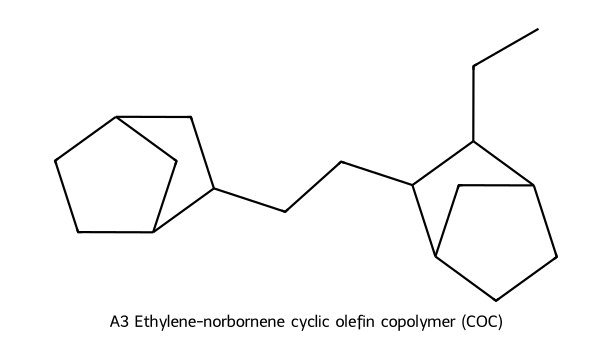

**Mechanism trace:**

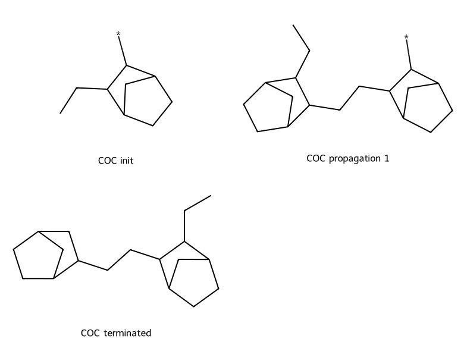

| step | SMILES |
| --- | --- |
| init | `*C1C2CCC(C2)C1CC` |
| propagation 1 | `*C1C2CCC(C2)C1CCC1C2CCC(C2)C1CC` |
| terminated | `CCC1C2CCC(C2)C1CCC1CC2CCC1C2` |

## A4 — Ethylene–propylene rubber (EPR)

**Family:** Addition  
**Recipe / topology:** two non-ring vinyl pair (CH2 attachment; H caps)

| field | value |
| --- | --- |
| mechanism | `A4` |
| family | Addition |
| reaction SMARTS | `[C&X3;H2,H1,H0;!R:1]=[C&X3;H2,H1,H0;!R:2].[C&X3;H2,H1,H0;!R:3]=[C&X3;H2,H1,H0;!R:4]>>*-[C&X4:1][C&X4:2][C&X4:3][C&X4:4]-*` |
| registry type | `addition` |
| polymer class | `polyolefin` |
| practical polymer | Ethylene–propylene rubber (EPR) |
| status | commercial |
| monomer(s) | `C=C` + `C=CC` |
| residues / propagation steps | 1 |
| generated product | `CCCCCC(C)CCC` |

Commercial EPR/EPDM backbone. The paired trace models the comonomer pair as alternating insertion, forcing one ethylene and one propylene into each propagation step; the default frontier cap alone would pick the same monomer twice.

**Compiled recipe (what the driver runs):**

- `init_smarts`: `[C&X3;H2:1]=;!@[C&X3;H2,H1,H0:2].[C&X3;H2:3]=;!@[C&X3;H2,H1,H0:4]>>[C&X4:1][C&X4:2][C&X4:3][C&X4:4]-*`
- `prop_smarts`: `[C:0][C&X4:1]-*.[C&X3;H2:2]=;!@[C&X3;H2,H1,H0:3].[C&X3;H2:4]=;!@[C&X3;H2,H1,H0:5]>>[C:0][C:1][C&X4:2][C&X4:3][C&X4:4][C&X4:5]-*`
- `term_smarts`: `[C:0][C:1]-*>>[C:0][C:1]`

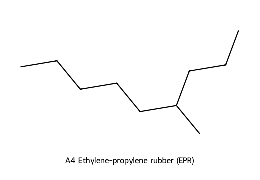

**Mechanism trace:**

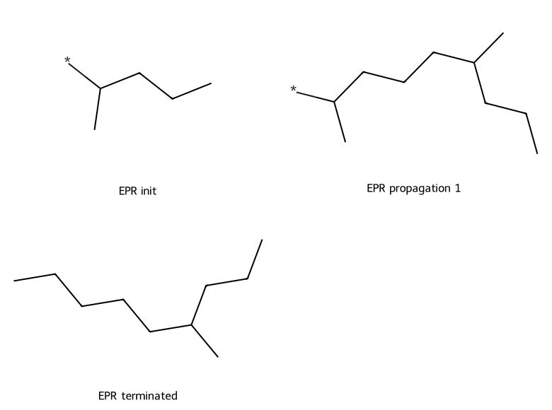

| step | SMILES |
| --- | --- |
| init | `*C(C)CCC` |
| propagation 1 | `*C(C)CCCC(C)CCC` |
| terminated | `CCCCCC(C)CCC` |

## C1 — Poly(ethylene terephthalate) (PET)

**Family:** Coupling  
**Recipe / topology:** AA+BB; HA; acid/acyl halide or methyl-ester transesterification

| field | value |
| --- | --- |
| mechanism | `C1` |
| family | Coupling |
| reaction SMARTS | `([C&X3:1](=O)[O&X2&H1,Cl,Br].[C&X3:2](=O)[O&X2&H1,Cl,Br]).([O,S;X2;H1;!$([O,S]C=*):3].[O,S;X2;H1;!$([O,S]C=*):4])>>(*-[C&X3:1]=O.[C&X3:2](=O)-[O,S;X2;!$([O,S]C=*):3].[O,S;X2;!$([O,S]C=*):4]-*)` |
| registry type | `step_growth` |
| polymer class | `polyester` |
| practical polymer | Poly(ethylene terephthalate) (PET) |
| status | commercial |
| monomer(s) | `O=C(O)c1ccc(C(=O)O)cc1` + `OCCO` |
| residues / propagation steps | 2 |
| generated product | `O=C(O)c1ccc(C(=O)OCCO)cc1` |

Commodity polyester; the acid and alcohol ends are consumed one at a time, so the chain keeps its real -COOH and -OH terminal groups.

**Compiled recipe (what the driver runs):**

- `coupling_smarts`:
  - `[C&X3:1](=[O:6])([#6:3])[O&X2&H1,Cl,Br,I].[#8,#16;X2;H1;!$([#8,#16][C&X3](=[O,S]));!$([#8,#16][S,P,B,N]);!$([#8,#16][#8]);!$([#8,#16][C&X3]=[C,N]):2]>>[C&X3:1](=[O:6])([#6:3])[O,S&X2:2]`
  - `[C&X3:1](=[O:6])([#6:3])[O&X2][CX4;H3:7].[#8,#16;X2;H1;!$([#8,#16][C&X3](=[O,S]));!$([#8,#16][S,P,B,N]);!$([#8,#16][#8]);!$([#8,#16][C&X3]=[C,N]):2]>>[C&X3:1](=[O:6])([#6:3])[O,S&X2:2]`

**All registry keys assigned to C1:**

- `([C&X3:1](=O)[O&X2&H1,Cl,Br].[C&X3:2](=O)[O&X2&H1,Cl,Br]).([O,S;X2;H1;!$([O,S]C=*):3].[O,S;X2;H1;!$([O,S]C=*):4])>>(*-[C&X3:1]=O.[C&X3:2](=O)-[O,S;X2;!$([O,S]C=*):3].[O,S;X2;!$([O,S]C=*):4]-*)`
- `([O&X2&H1&!$(OC=*):1].[C&X3:2](=O)[O&X2&H1]).([O&X2&H1&!$(OC=*):3].[C&X3:4](=O)[O&X2&H1])>>(*-[O&X2:1].[C&X3:2](=O)[O&X2:3].[C&X3:4](=O)-*)`
- `([O&X2&H1&!$(OC=*):1].[C&X3:2](=O)[O&X2&H1])>>(*-[O&X2:1].[C&X3:2](=O)-*)`

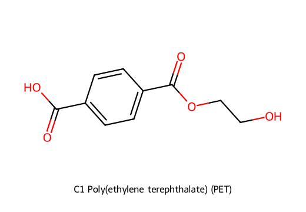

**Mechanism trace:**

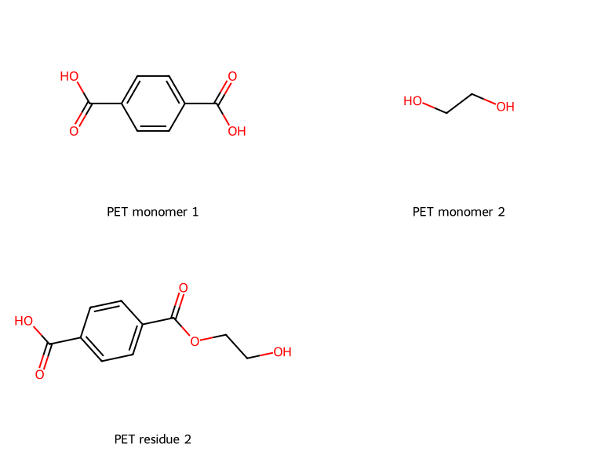

| step | SMILES |
| --- | --- |
| monomer 1 | `O=C(O)c1ccc(C(=O)O)cc1` |
| monomer 2 | `OCCO` |
| residue 2 | `O=C(O)c1ccc(C(=O)OCCO)cc1` |

## C2 — Nylon-6,6

**Family:** Coupling  
**Recipe / topology:** AA+BB; HA AA+BB; HA AB (amidine OK; amide/SO2/P=O blocked)

| field | value |
| --- | --- |
| mechanism | `C2` |
| family | Coupling |
| reaction SMARTS | `([C&X3:1](=O)[O&X2&H1,Cl,Br].[C&X3:2](=O)[O&X2&H1,Cl,Br]).([N&X3;H2,H1;!$(NC=*):3].[N&X3;H2,H1;!$(NC=*):4])>>(*-[C&X3:1]=O.[C&X3:2](=O)-[N&X3&!$(NC=*):3].[N&X3&!$(NC=*):4]-*)` |
| registry type | `step_growth` |
| polymer class | `polyamide` |
| practical polymer | Nylon-6,6 |
| status | commercial |
| monomer(s) | `O=C(O)CCCCC(=O)O` + `NCCCCCCN` |
| residues / propagation steps | 2 |
| generated product | `NCCCCCCNC(=O)CCCCC(=O)O` |

Commodity polyamide from adipic acid and hexamethylenediamine; the amide coupling leaves acid and amine ends.

**Compiled recipe (what the driver runs):**

- `coupling_smarts`: `[C&X3:1](=[O:6])([#6:3])[O&X2&H1,Cl,Br,I].[N&X3;H2,H1;!$([N][C&X3](=[O,S]));!$([N][S,P](=[O])):2]>>[C&X3:1](=[O:6])([#6:3])[N&X3:2]`

**All registry keys assigned to C2:**

- `([C&X3:1](=O)[O&X2&H1,Cl,Br].[C&X3:2](=O)[O&X2&H1,Cl,Br]).([N&X3;H2,H1;!$(NC=*):3].[N&X3;H2,H1;!$(NC=*):4])>>(*-[C&X3:1]=O.[C&X3:2](=O)-[N&X3&!$(NC=*):3].[N&X3&!$(NC=*):4]-*)`
- `([N&X3;H2,H1;!$(NC=*):1].[C&X3:2](=O)[O&X2&H1]).([N&X3;H2,H1;!$(NC=*):3].[C&X3:4](=O)[O&X2&H1])>>(*-[N&X3&!$(NC=*):1].[C&X3:2](=O)[N&X3&!$(NC=*):3].[C&X3:4](=O)-*)`
- `([N&X3;H2,H1;!$(OC=*):1].[C&X3:2](=O)[O&X2&H1])>>(*-[N&X3:1].[C&X3:2](=O)-*)`

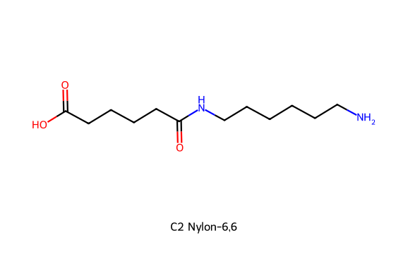

**Mechanism trace:**

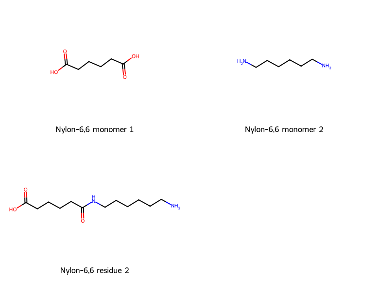

| step | SMILES |
| --- | --- |
| monomer 1 | `O=C(O)CCCCC(=O)O` |
| monomer 2 | `NCCCCCCN` |
| residue 2 | `NCCCCCCNC(=O)CCCCC(=O)O` |

## C3 — Polyurethane (HDI + 1,4-butanediol)

**Family:** Coupling  
**Recipe / topology:** AA+BB (NCO + guarded OH/SH)

| field | value |
| --- | --- |
| mechanism | `C3` |
| family | Coupling |
| reaction SMARTS | `([N&X2:1]=[C&X2]=[O&X1,S&X1:2].[N&X2:3]=[C&X2:4]=[O&X1,S&X1:5]).([O&X2,S&X2;H1;!$([O,S]C=*):6].[O&X2,S&X2;H1;!$([O,S]C=*):7])>>(*-[C&X3](=[O&X1,S&X1:2])[N&X3:1].[N&X3:3][C&X3:4](=[O&X1,S&X1:5])[O&X2,S&X2;!$([O,S]C=*):6].[O&X2,S&X2;!$([O,S]C=*):7]-*)` |
| registry type | `step_growth` |
| polymer class | `polyurethane` |
| practical polymer | Polyurethane (HDI + 1,4-butanediol) |
| status | commercial |
| monomer(s) | `O=C=NCCCCCCN=C=O` + `OCCCCO` |
| residues / propagation steps | 2 |
| generated product | `O=C=NCCCCCCNC(=O)OCCCCO` |

Polyurethane elastomer/coating chemistry; the urethane coupling consumes one isocyanate and one alcohol, and the unreacted groups remain the chain ends.

**Compiled recipe (what the driver runs):**

- `coupling_smarts`: `[N&X2:1]=[C&X2:2]=[#8,#16;X1:3].[#8,#16;X2;H1;!$([#8,#16][C&X3](=[O,S]));!$([#8,#16][S,P,B,N]);!$([#8,#16][#8]);!$([#8,#16][C&X3]=[C,N]):4]>>[N&X3:1][C&X3:2](=[#8,#16;X1:3])[O,S&X2:4]`

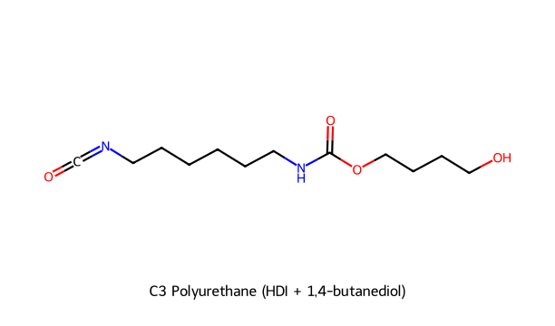

**Mechanism trace:**

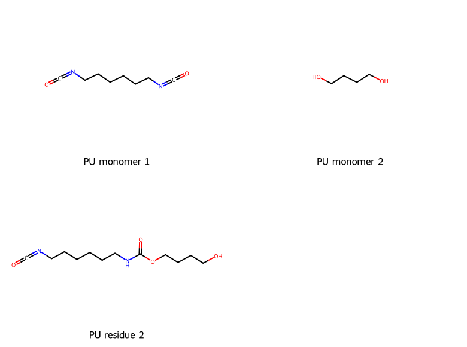

| step | SMILES |
| --- | --- |
| monomer 1 | `O=C=NCCCCCCN=C=O` |
| monomer 2 | `OCCCCO` |
| residue 2 | `O=C=NCCCCCCNC(=O)OCCCCO` |

## C4 — Kapton-type polyimide (PMDA + ODA)

**Family:** Coupling  
**Recipe / topology:** AA+BB (cyclic anhydride + diamine; 5-/6-membered only)

| field | value |
| --- | --- |
| mechanism | `C4` |
| family | Coupling |
| reaction SMARTS | `([C&X3,c;R:1](=[O&X1])[O&X2,o;R][C&X3,c;R:2]=[O&X1].[C&X3,c;R:3](=[O&X1])[O&X2,o;R][C&X3,c;R:4]=[O&X1]).([C,c:5][N&X3&H2&!$(N[C,S]=*)].[C,c:6][N&X3&H2&!$(N[C,S]=*)])>>([C&X3,c;R:1](=[O&X1])[N&X3&R]([C,c:5])[C&X3,c;R:2]=[O&X1].[C,c:6]-*.[C&X3,c;R:3](=[O&X1])[N&X3&R](-*)[C&X3&R:4]=[O&X1])` |
| registry type | `step_growth` |
| polymer class | `polyimide` |
| practical polymer | Kapton-type polyimide (PMDA + ODA) |
| status | commercial |
| monomer(s) | `O=C1OC(=O)c2cc3c(=O)oc(=O)c3cc12` + `Nc1ccc(Oc2ccc(N)cc2)cc1` |
| residues / propagation steps | 2 |
| generated product | `Nc1ccc(Oc2ccc(-n3c(=O)c4cc5c(=O)oc(=O)c5cc4c3=O)cc2)cc1` |

Kapton-type polyimide from pyromellitic dianhydride and 4,4'-oxydianiline; the cyclic dianhydride and diamine form the net cyclodehydration product.

**Compiled recipe (what the driver runs):**

- `coupling_smarts`: `[#6&X3&R:1](=[#8:2])[#8&X2&R;$([#8]1[#6&X3](=[#8])[#6,#7,#8,#16][#6,#7,#8,#16][#6&X3]1=[#8]),$([#8]1[#6&X3](=[#8])[#6,#7,#8,#16][#6,#7,#8,#16][#6,#7,#8,#16][#6&X3]1=[#8])][#6&X3&R:4](=[#8:5]).[N&X3;H2;!$([N][C&X3](=[O,S]));!$([N][S,P](=[O])):6]>>[#6&X3:1](=[#8:2])[N&X3:6][#6&X3:4](=[#8:5])`

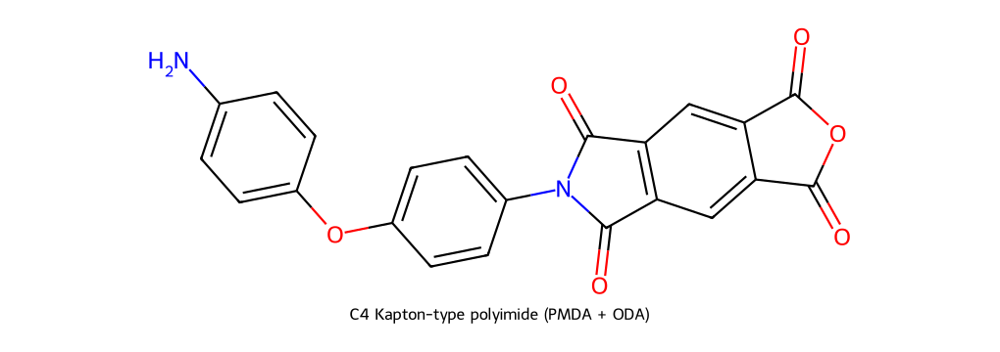

**Mechanism trace:**

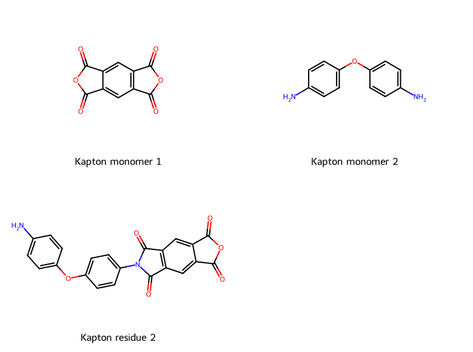

| step | SMILES |
| --- | --- |
| monomer 1 | `O=c1oc(=O)c2cc3c(=O)oc(=O)c3cc12` |
| monomer 2 | `Nc1ccc(Oc2ccc(N)cc2)cc1` |
| residue 2 | `Nc1ccc(Oc2ccc(-n3c(=O)c4cc5c(=O)oc(=O)c5cc4c3=O)cc2)cc1` |

## C5 — Polyoxazolidone (BADGE + MDI)

**Family:** Coupling  
**Recipe / topology:** AA+BB (epoxide + NCO; 4 regio tiers)

| field | value |
| --- | --- |
| mechanism | `C5` |
| family | Coupling |
| reaction SMARTS | `([C&X4;H2,H1,H0;R:1]1[O&X2&R:2][C&X4;H1,H0;R:3]1.[C&X4;H2,H1,H0;R:4]1[O&X2&R:5][C&X4;H1,H0;R:6]1).([O&X1,S&X1:7]=[C&X2:8]=[N&X2:9].[O&X1,S&X1:10]=[C&X2:11]=[N&X2:12][C,c:13])>>([C&X4&R:6]1[O&X2&R:5][C&X2&R:8](=[O&X1,S&X1:7])[N&X3&R:9][C&X4&R:4]1.[C&X4&R:3]1[O&X2&R:2][C&X2&R:11](=[O&X1,S&X1:10])[N&X3&R:12](-*)[C&X4&R:1]1.[C,c:13]-*)` |
| registry type | `step_growth` |
| polymer class | `polyoxazolidone` |
| practical polymer | Polyoxazolidone (BADGE + MDI) |
| status | known/specialty |
| monomer(s) | `CC(C)(c1ccc(OCC2CO2)cc1)c1ccc(OCC2CO2)cc1` + `O=C=Nc1ccc(Cc2ccc(N=C=O)cc2)cc1` |
| residues / propagation steps | 2 |
| generated product | `CC(C)(c1ccc(OCC2CO2)cc1)c1ccc(OCC2CN(c3ccc(Cc4ccc(N=C=O)cc4)cc3)C(=O)O2)cc1` |

Specialty high-performance polymer from bisphenol A diglycidyl ether and MDI; the isocyanate N attacks the less hindered epoxide carbon to form the oxazolidinone ring.

**Compiled recipe (what the driver runs):**

- `coupling_smarts`:
  - `[C&X4;H0,H1;R:1]1[O&X2&R:2][C&X4;H2;R:3]1.[N&X2:4]=[C&X2:5]=[#8,#16;X1:6]>>[C:1]1[O:2][C:5](=[#8,#16:6])[N:4][C:3]1`
  - `[C&X4;H0,H1;R:1]1[O&X2&R:2][C&X4;H1;R:3]1.[N&X2:4]=[C&X2:5]=[#8,#16;X1:6]>>[C:1]1[O:2][C:5](=[#8,#16:6])[N:4][C:3]1`
  - `[C&X4;H2;R:1]1[O&X2&R:2][C&X4;H2;R:3]1.[N&X2:4]=[C&X2:5]=[#8,#16;X1:6]>>[C:1]1[O:2][C:5](=[#8,#16:6])[N:4][C:3]1`
  - `[C&X4;H0;R:1]1[O&X2&R:2][C&X4;H0;R:3]1.[N&X2:4]=[C&X2:5]=[#8,#16;X1:6]>>[C:1]1[O:2][C:5](=[#8,#16:6])[N:4][C:3]1`

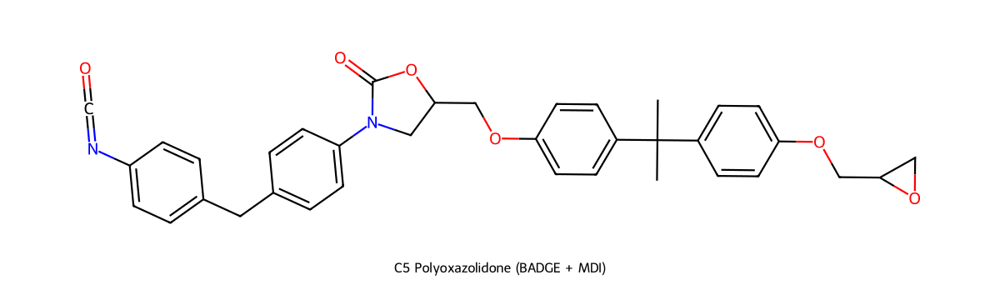

**Mechanism trace:**

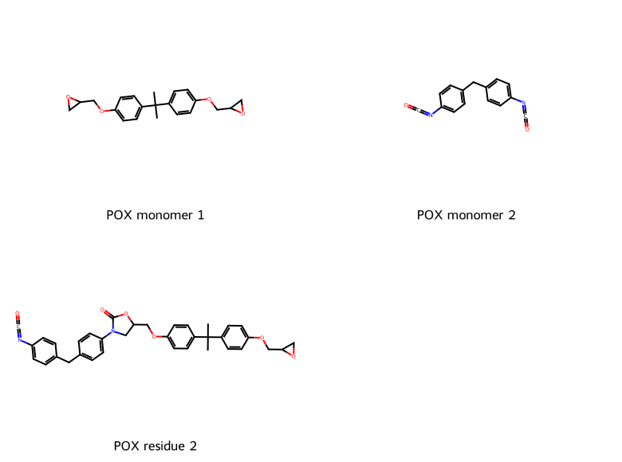

| step | SMILES |
| --- | --- |
| monomer 1 | `CC(C)(c1ccc(OCC2CO2)cc1)c1ccc(OCC2CO2)cc1` |
| monomer 2 | `O=C=Nc1ccc(Cc2ccc(N=C=O)cc2)cc1` |
| residue 2 | `CC(C)(c1ccc(OCC2CO2)cc1)c1ccc(OCC2CN(c3ccc(Cc4ccc(N=C=O)cc4)cc3)C(=O)O2)cc1` |

## C6 — Bisphenol A polycarbonate (BPA-PC)

**Family:** Coupling  
**Recipe / topology:** AB (diol + phosgene)

| field | value |
| --- | --- |
| mechanism | `C6` |
| family | Coupling |
| reaction SMARTS | `([O,S;X2;H1;!$([O,S]C=*):1].[O,S;X2;H1;!$([O,S]C=*):2]).[C&-]#[O&+]>>(*-[O,S;X2;!$([O,S]C=*):1].[O,S;X2;!$([O,S]C=*):2][C&X3](=O)-*)` |
| registry type | `step_growth` |
| polymer class | `polyester` |
| practical polymer | Bisphenol A polycarbonate (BPA-PC) |
| status | commercial |
| monomer(s) | `CC(C)(c1ccc(O)cc1)c1ccc(O)cc1` |
| residues / propagation steps | 2 |
| generated product | `CC(C)(c1ccc(O)cc1)c1ccc(OC(=O)Oc2ccc(C(C)(C)c3ccc(O)cc3)cc2)cc1` |

Lexan-type polycarbonate made by the phosgene route; the carbonate carbonyl and oxygen come from the phosgene reagent, so no atom is invented.

**Compiled recipe (what the driver runs):**

- `coupling_smarts`: `[#8,#16;X2;H1;!$([#8,#16][C&X3](=[O,S]));!$([#8,#16][S,P,B,N]);!$([#8,#16][#8]);!$([#8,#16][C&X3]=[C,N]):1].[C&X3:3](=[O:4])([Cl,Br])[Cl,Br].[#8,#16;X2;H1;!$([#8,#16][C&X3](=[O,S]));!$([#8,#16][S,P,B,N]);!$([#8,#16][#8]);!$([#8,#16][C&X3]=[C,N]):2]>>[#8,#16;X2:1][C&X3:3](=[O:4])[#8,#16;X2:2]`
- `reagents`: `ClC(=O)Cl`

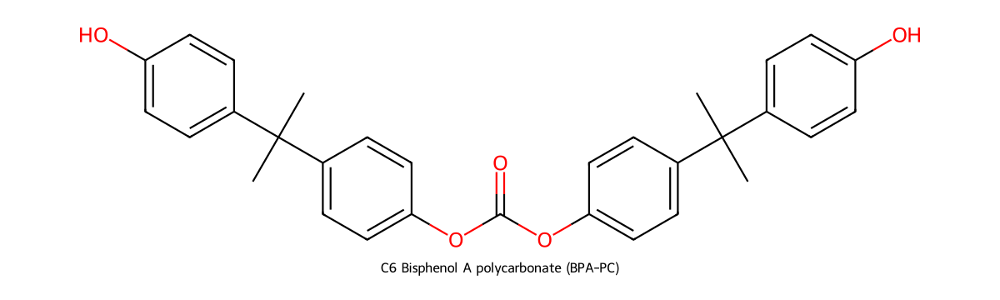

**Mechanism trace:**

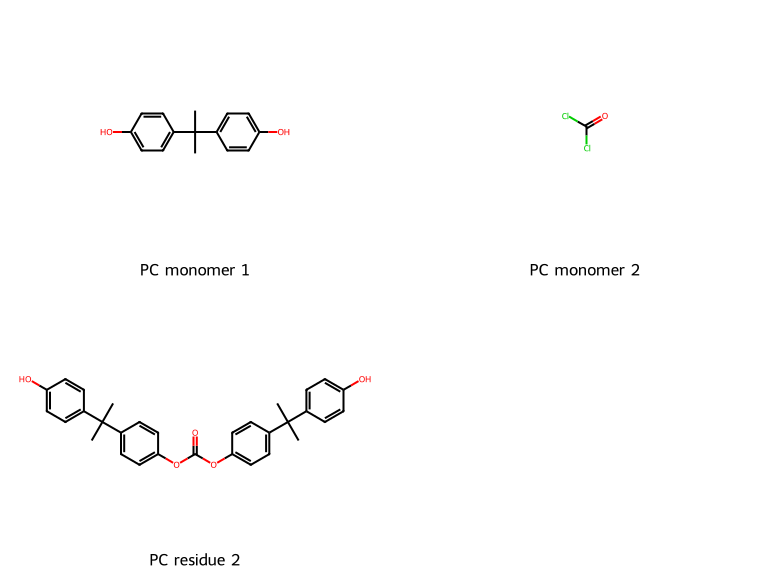

| step | SMILES |
| --- | --- |
| monomer 1 | `CC(C)(c1ccc(O)cc1)c1ccc(O)cc1` |
| monomer 2 | `O=C(Cl)Cl` |
| residue 2 | `CC(C)(c1ccc(O)cc1)c1ccc(OC(=O)Oc2ccc(C(C)(C)c3ccc(O)cc3)cc2)cc1` |

## C7 — Poly(ether ether ketone) (PEEK)

**Family:** Coupling  
**Recipe / topology:** PEEK; PES; PAEN (ketone/sulfone/nitrile; same-ring or phenyl-spaced; F before Cl/Br/I)

| field | value |
| --- | --- |
| mechanism | `C7` |
| family | Coupling |
| reaction SMARTS | `[c:1]1[c:2][c:3](F)[c:4][c:5][c:6]1[C&X3](=[O&X1])[c:7]1[c:8][c:9][c:10](F)[c:11][c:12]1.([O&X2&H1&!$([O,S]C=*):13].[O&X2&H1&!$([O,S]C=*):14])>>([c:1]1[c:2][c:3](-*)[c:4][c:5][c:6]1[C&X3](=[O&X1])[c:7]1[c:8][c:9][c:10]([O&X2&!$([O,S]C=*):13])[c:11][c:12]1.[O&X2&!$([O,S]C=*):14]-*)` |
| registry type | `step_growth` |
| polymer class | `polyether` |
| practical polymer | Poly(ether ether ketone) (PEEK) |
| status | commercial |
| monomer(s) | `O=C(c1ccc(F)cc1)c1ccc(F)cc1` + `Oc1ccc(O)cc1` |
| residues / propagation steps | 2 |
| generated product | `O=C(c1ccc(F)cc1)c1ccc(Oc2ccc(O)cc2)cc1` |

Victrex-type PEEK made by nucleophilic aromatic substitution; the para-ketone activates the aryl fluoride, and the second Ar-F remains an exact terminal group.

**Compiled recipe (what the driver runs):**

- `coupling_smarts`:
  - `[c:1]1([F])[c:3][c:4][c:5]([C&X3:6](=[O:7])[#6:8])[c:9][c:10]1.[#8,#16;X2;H1;!$([#8,#16][C&X3](=[O,S]));!$([#8,#16][S,P,B,N]);!$([#8,#16][#8]);!$([#8,#16][C&X3]=[C,N]):11]>>[c:1]1([#8,#16;X2:11])[c:3][c:4][c:5]([C&X3:6](=[O:7])[#6:8])[c:9][c:10]1`
  - `[c:1]1([F])[c:3][c:4][c:5]([S&X4:6](=[O:7])(=[O:8])[#6:9])[c:12][c:13]1.[#8,#16;X2;H1;!$([#8,#16][C&X3](=[O,S]));!$([#8,#16][S,P,B,N]);!$([#8,#16][#8]);!$([#8,#16][C&X3]=[C,N]):11]>>[c:1]1([#8,#16;X2:11])[c:3][c:4][c:5]([S&X4:6](=[O:7])(=[O:8])[#6:9])[c:12][c:13]1`
  - `[c:1]1([F])[c:3][c:4][c:5]([C&X2:6]#[N&X1:7])[c:9][c:10]1.[#8,#16;X2;H1;!$([#8,#16][C&X3](=[O,S]));!$([#8,#16][S,P,B,N]);!$([#8,#16][#8]);!$([#8,#16][C&X3]=[C,N]):11]>>[c:1]1([#8,#16;X2:11])[c:3][c:4][c:5]([C&X2:6]#[N&X1:7])[c:9][c:10]1`
  - `[c:1]1([F])[c:2]([C&X2:6]#[N&X1:7])[c:3][c:4][c:5][c:10]1.[#8,#16;X2;H1;!$([#8,#16][C&X3](=[O,S]));!$([#8,#16][S,P,B,N]);!$([#8,#16][#8]);!$([#8,#16][C&X3]=[C,N]):11]>>[c:1]1([#8,#16;X2:11])[c:2]([C&X2:6]#[N&X1:7])[c:3][c:4][c:5][c:10]1`
  - `[c:1]1([F])[c:3][c:4][c:5](-[c:9]2[c:10][c:11][c:12]([C&X3:6](=[O:7])[#6:8])[c:13][c:14]2)[c:15][c:16]1.[#8,#16;X2;H1;!$([#8,#16][C&X3](=[O,S]));!$([#8,#16][S,P,B,N]);!$([#8,#16][#8]);!$([#8,#16][C&X3]=[C,N]):17]>>[c:1]1([#8,#16;X2:17])[c:3][c:4][c:5](-[c:9]2[c:10][c:11][c:12]([C&X3:6](=[O:7])[#6:8])[c:13][c:14]2)[c:15][c:16]1`
  - `[c:1]1([F])[c:3][c:4][c:5](-[c:9]2[c:10][c:11][c:12]([S&X4:6](=[O:7])(=[O:8])[#6:18])[c:13][c:14]2)[c:15][c:16]1.[#8,#16;X2;H1;!$([#8,#16][C&X3](=[O,S]));!$([#8,#16][S,P,B,N]);!$([#8,#16][#8]);!$([#8,#16][C&X3]=[C,N]):17]>>[c:1]1([#8,#16;X2:17])[c:3][c:4][c:5](-[c:9]2[c:10][c:11][c:12]([S&X4:6](=[O:7])(=[O:8])[#6:18])[c:13][c:14]2)[c:15][c:16]1`
  - `[c:1]1([F])[c:3][c:4][c:5](-[c:9]2[c:10][c:11][c:12]([C&X2:6]#[N&X1:7])[c:13][c:14]2)[c:15][c:16]1.[#8,#16;X2;H1;!$([#8,#16][C&X3](=[O,S]));!$([#8,#16][S,P,B,N]);!$([#8,#16][#8]);!$([#8,#16][C&X3]=[C,N]):17]>>[c:1]1([#8,#16;X2:17])[c:3][c:4][c:5](-[c:9]2[c:10][c:11][c:12]([C&X2:6]#[N&X1:7])[c:13][c:14]2)[c:15][c:16]1`
  - `[c:1]1([F])[c:10][c:11]2[c:12][c:13][c:14]([C&X3:6](=[O:7])[#6:8])[c:15][c:16]2[c:17][c:18]1.[#8,#16;X2;H1;!$([#8,#16][C&X3](=[O,S]));!$([#8,#16][S,P,B,N]);!$([#8,#16][#8]);!$([#8,#16][C&X3]=[C,N]):9]>>[c:1]1([#8,#16;X2:9])[c:10][c:11]2[c:12][c:13][c:14]([C&X3:6](=[O:7])[#6:8])[c:15][c:16]2[c:17][c:18]1`
  - `[c:1]1([F])[c:10][c:11]2[c:12][c:13][c:14]([S&X4:6](=[O:7])(=[O:8])[#6:19])[c:15][c:16]2[c:17][c:18]1.[#8,#16;X2;H1;!$([#8,#16][C&X3](=[O,S]));!$([#8,#16][S,P,B,N]);!$([#8,#16][#8]);!$([#8,#16][C&X3]=[C,N]):9]>>[c:1]1([#8,#16;X2:9])[c:10][c:11]2[c:12][c:13][c:14]([S&X4:6](=[O:7])(=[O:8])[#6:19])[c:15][c:16]2[c:17][c:18]1`
  - `[c:1]1([F])[c:10][c:11]2[c:12][c:13][c:14]([C&X2:6]#[N&X1:7])[c:15][c:16]2[c:17][c:18]1.[#8,#16;X2;H1;!$([#8,#16][C&X3](=[O,S]));!$([#8,#16][S,P,B,N]);!$([#8,#16][#8]);!$([#8,#16][C&X3]=[C,N]):9]>>[c:1]1([#8,#16;X2:9])[c:10][c:11]2[c:12][c:13][c:14]([C&X2:6]#[N&X1:7])[c:15][c:16]2[c:17][c:18]1`
  - `[c:1]1([Cl,Br,I])[c:3][c:4][c:5]([C&X3:6](=[O:7])[#6:8])[c:9][c:10]1.[#8,#16;X2;H1;!$([#8,#16][C&X3](=[O,S]));!$([#8,#16][S,P,B,N]);!$([#8,#16][#8]);!$([#8,#16][C&X3]=[C,N]):11]>>[c:1]1([#8,#16;X2:11])[c:3][c:4][c:5]([C&X3:6](=[O:7])[#6:8])[c:9][c:10]1`
  - `[c:1]1([Cl,Br,I])[c:3][c:4][c:5]([S&X4:6](=[O:7])(=[O:8])[#6:9])[c:12][c:13]1.[#8,#16;X2;H1;!$([#8,#16][C&X3](=[O,S]));!$([#8,#16][S,P,B,N]);!$([#8,#16][#8]);!$([#8,#16][C&X3]=[C,N]):11]>>[c:1]1([#8,#16;X2:11])[c:3][c:4][c:5]([S&X4:6](=[O:7])(=[O:8])[#6:9])[c:12][c:13]1`
  - `[c:1]1([Cl,Br,I])[c:3][c:4][c:5]([C&X2:6]#[N&X1:7])[c:9][c:10]1.[#8,#16;X2;H1;!$([#8,#16][C&X3](=[O,S]));!$([#8,#16][S,P,B,N]);!$([#8,#16][#8]);!$([#8,#16][C&X3]=[C,N]):11]>>[c:1]1([#8,#16;X2:11])[c:3][c:4][c:5]([C&X2:6]#[N&X1:7])[c:9][c:10]1`
  - `[c:1]1([Cl,Br,I])[c:2]([C&X2:6]#[N&X1:7])[c:3][c:4][c:5][c:10]1.[#8,#16;X2;H1;!$([#8,#16][C&X3](=[O,S]));!$([#8,#16][S,P,B,N]);!$([#8,#16][#8]);!$([#8,#16][C&X3]=[C,N]):11]>>[c:1]1([#8,#16;X2:11])[c:2]([C&X2:6]#[N&X1:7])[c:3][c:4][c:5][c:10]1`
  - `[c:1]1([Cl,Br,I])[c:3][c:4][c:5](-[c:9]2[c:10][c:11][c:12]([C&X3:6](=[O:7])[#6:8])[c:13][c:14]2)[c:15][c:16]1.[#8,#16;X2;H1;!$([#8,#16][C&X3](=[O,S]));!$([#8,#16][S,P,B,N]);!$([#8,#16][#8]);!$([#8,#16][C&X3]=[C,N]):17]>>[c:1]1([#8,#16;X2:17])[c:3][c:4][c:5](-[c:9]2[c:10][c:11][c:12]([C&X3:6](=[O:7])[#6:8])[c:13][c:14]2)[c:15][c:16]1`
  - `[c:1]1([Cl,Br,I])[c:3][c:4][c:5](-[c:9]2[c:10][c:11][c:12]([S&X4:6](=[O:7])(=[O:8])[#6:18])[c:13][c:14]2)[c:15][c:16]1.[#8,#16;X2;H1;!$([#8,#16][C&X3](=[O,S]));!$([#8,#16][S,P,B,N]);!$([#8,#16][#8]);!$([#8,#16][C&X3]=[C,N]):17]>>[c:1]1([#8,#16;X2:17])[c:3][c:4][c:5](-[c:9]2[c:10][c:11][c:12]([S&X4:6](=[O:7])(=[O:8])[#6:18])[c:13][c:14]2)[c:15][c:16]1`
  - `[c:1]1([Cl,Br,I])[c:3][c:4][c:5](-[c:9]2[c:10][c:11][c:12]([C&X2:6]#[N&X1:7])[c:13][c:14]2)[c:15][c:16]1.[#8,#16;X2;H1;!$([#8,#16][C&X3](=[O,S]));!$([#8,#16][S,P,B,N]);!$([#8,#16][#8]);!$([#8,#16][C&X3]=[C,N]):17]>>[c:1]1([#8,#16;X2:17])[c:3][c:4][c:5](-[c:9]2[c:10][c:11][c:12]([C&X2:6]#[N&X1:7])[c:13][c:14]2)[c:15][c:16]1`
  - `[c:1]1([Cl,Br,I])[c:10][c:11]2[c:12][c:13][c:14]([C&X3:6](=[O:7])[#6:8])[c:15][c:16]2[c:17][c:18]1.[#8,#16;X2;H1;!$([#8,#16][C&X3](=[O,S]));!$([#8,#16][S,P,B,N]);!$([#8,#16][#8]);!$([#8,#16][C&X3]=[C,N]):9]>>[c:1]1([#8,#16;X2:9])[c:10][c:11]2[c:12][c:13][c:14]([C&X3:6](=[O:7])[#6:8])[c:15][c:16]2[c:17][c:18]1`
  - `[c:1]1([Cl,Br,I])[c:10][c:11]2[c:12][c:13][c:14]([S&X4:6](=[O:7])(=[O:8])[#6:19])[c:15][c:16]2[c:17][c:18]1.[#8,#16;X2;H1;!$([#8,#16][C&X3](=[O,S]));!$([#8,#16][S,P,B,N]);!$([#8,#16][#8]);!$([#8,#16][C&X3]=[C,N]):9]>>[c:1]1([#8,#16;X2:9])[c:10][c:11]2[c:12][c:13][c:14]([S&X4:6](=[O:7])(=[O:8])[#6:19])[c:15][c:16]2[c:17][c:18]1`
  - `[c:1]1([Cl,Br,I])[c:10][c:11]2[c:12][c:13][c:14]([C&X2:6]#[N&X1:7])[c:15][c:16]2[c:17][c:18]1.[#8,#16;X2;H1;!$([#8,#16][C&X3](=[O,S]));!$([#8,#16][S,P,B,N]);!$([#8,#16][#8]);!$([#8,#16][C&X3]=[C,N]):9]>>[c:1]1([#8,#16;X2:9])[c:10][c:11]2[c:12][c:13][c:14]([C&X2:6]#[N&X1:7])[c:15][c:16]2[c:17][c:18]1`

**All registry keys assigned to C7:**

- `[c:1]1[c:2][c:3](F)[c:4][c:5][c:6]1[C&X3](=[O&X1])[c:7]1[c:8][c:9][c:10](F)[c:11][c:12]1.([O&X2&H1&!$([O,S]C=*):13].[O&X2&H1&!$([O,S]C=*):14])>>([c:1]1[c:2][c:3](-*)[c:4][c:5][c:6]1[C&X3](=[O&X1])[c:7]1[c:8][c:9][c:10]([O&X2&!$([O,S]C=*):13])[c:11][c:12]1.[O&X2&!$([O,S]C=*):14]-*)`
- `[c:1]1[c:2][c:3]([F,Cl,Br,I])[c:4][c:5][c:6]1[S&X4](=[O&X1])(=[O&X1])[c:7]1[c:8][c:9][c:10]([F,Cl,Br,I])[c:11][c:12]1.([O&X2&H1&!$([O,S]C=*):13].[O&X2&H1&!$([O,S]C=*):14])>>([c:1]1[c:2][c:3](-*)[c:4][c:5][c:6]1[S&X4](=[O&X1])(=[O&X1])[c:7]1[c:8][c:9][c:10]([O&X2&!$([O,S]C=*):13])[c:11][c:12]1.[O&X2&!$([O,S]C=*):14]-*)`

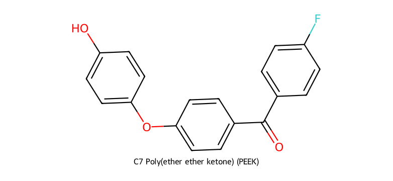

**Mechanism trace:**

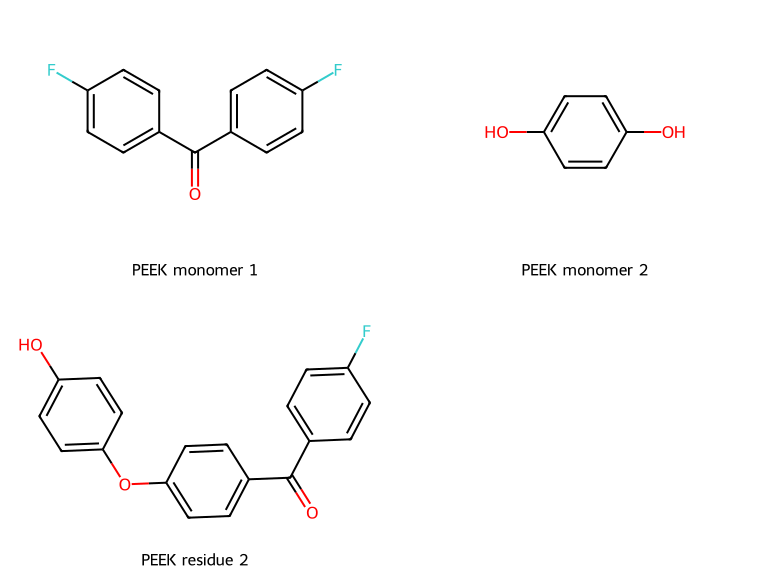

| step | SMILES |
| --- | --- |
| monomer 1 | `O=C(c1ccc(F)cc1)c1ccc(F)cc1` |
| monomer 2 | `Oc1ccc(O)cc1` |
| residue 2 | `O=C(c1ccc(F)cc1)c1ccc(Oc2ccc(O)cc2)cc1` |

## C8 — Poly(2,6-dimethyl-1,4-phenylene oxide) (PPO)

**Family:** Coupling  
**Recipe / topology:** AB (ortho-blocked phenol)

| field | value |
| --- | --- |
| mechanism | `C8` |
| family | Coupling |
| reaction SMARTS | `c1([O&H1:1])[c:2][c:3][c&H1:4][c:5][c:6]1>>c1([O&X2:1]-*)[c:2][c:3][c:4](-*)[c:5][c:6]1` |
| registry type | `step_growth` |
| polymer class | `polyether` |
| practical polymer | Poly(2,6-dimethyl-1,4-phenylene oxide) (PPO) |
| status | commercial |
| monomer(s) | `Cc1cccc(C)c1O` |
| residues / propagation steps | 2 |
| generated product | `Cc1cc(Oc2c(C)cccc2C)cc(C)c1O` |

Noryl-type PPO made by oxidative phenol coupling; the phenolic O-H couples to the para C-H of the next ring, leaving one free phenolic end.

**Compiled recipe (what the driver runs):**

- `coupling_smarts`: `[c:1]1([O&X2&H1:2])[cH0:10][c:11][c:12][c:13][cH0:14]1.[c:3]1([O&X2:4])[c:5][c:6][c&H1:7][c:8][c:9]1>>[c:1]1([O&X2:2][c:7]2[c:6][c:5][c:3]([O&X2:4])[c:9][c:8]2)[c:10][c:11][c:12][c:13][c:14]1`

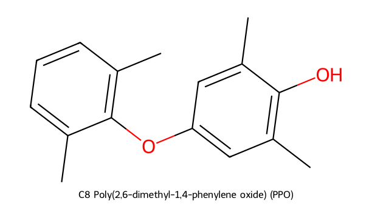

**Mechanism trace:**

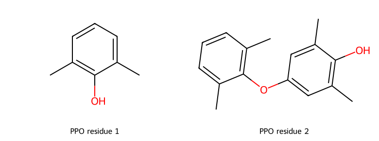

| step | SMILES |
| --- | --- |
| residue 1 | `Cc1cccc(C)c1O` |
| residue 2 | `Cc1cc(Oc2c(C)cccc2C)cc(C)c1O` |

## R1 — Polycaprolactone (PCL)

**Family:** Ring-opening  
**Recipe / topology:** lactone ROP; water init.; carbamic-acid end allowed

| field | value |
| --- | --- |
| mechanism | `R1` |
| family | Ring-opening |
| reaction SMARTS | `[C&X3&R:1](=[O&X1])[O&X2&R:2]>>(*-[C&X3:1]=[O&X1].[O&X2:2]-*)` |
| registry type | `ring_opening` |
| polymer class | `polyester` |
| practical polymer | Polycaprolactone (PCL) |
| status | commercial |
| monomer(s) | `O=C1CCCCCO1` |
| residues / propagation steps | 2 |
| generated product | `O=C(O)CCCCCOC(=O)CCCCCO` |

Biodegradable polyester; water opens caprolactone to 6-hydroxyhexanoic acid, and later cycles insert the opened hydroxyacid with the ROP-specific ester coupling.

**Compiled recipe (what the driver runs):**

- `prop_smarts`:
  - `[C&X3:1](=[O:6])([#6:3])[O&X2&H1,Cl,Br,I].[#8,#16;X2;H1;!$([#8,#16][C&X3](=[O,S]));!$([#8,#16][S,P,B,N]);!$([#8,#16][#8]);!$([#8,#16][C&X3]=[C,N]):2]>>[C&X3:1](=[O:6])([#6:3])[O,S&X2:2]`
  - `[C&X3:1](=[O:6])([#6:3])[O&X2&H1,Cl,Br,I].[#8;X2;H1;$([#8][C&X3](=[O,S])[#7]):2]>>[C&X3:1](=[O:6])([#6:3])[O&X2:2]`
- `ring_open_smarts`: `[C&X3&R:1](=[O&X1])[O&X2&R:2]>>(*-[C&X3:1]=[O&X1].[O&X2:2]-*)`

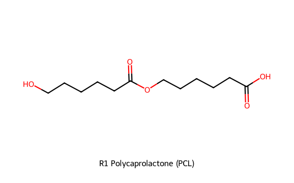

**Mechanism trace:**

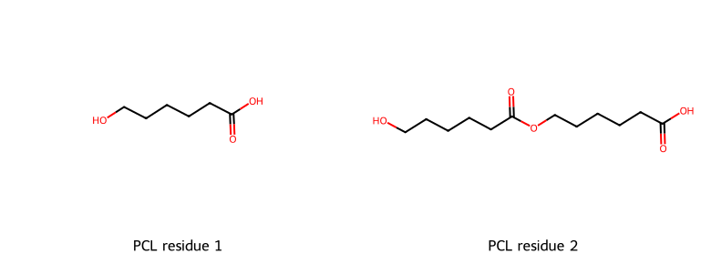

| step | SMILES |
| --- | --- |
| residue 1 | `O=C(O)CCCCCO` |
| residue 2 | `O=C(O)CCCCCOC(=O)CCCCCO` |

## R2 — Nylon-6

**Family:** Ring-opening  
**Recipe / topology:** lactam ROP; water init.; amidine OK, amide/SO2/P=O blocked

| field | value |
| --- | --- |
| mechanism | `R2` |
| family | Ring-opening |
| reaction SMARTS | `[C&X3&R:1](=[O&X1])[N&X3&R:2]>>(*-[C&X3:1]=[O&X1].[N&X3:2]-*)` |
| registry type | `ring_opening` |
| polymer class | `polyamide` |
| practical polymer | Nylon-6 |
| status | commercial |
| monomer(s) | `O=C1CCCCCN1` |
| residues / propagation steps | 2 |
| generated product | `NCCCCCC(=O)NCCCCCC(=O)O` |

Commodity polyamide; water opens caprolactam to 6-aminohexanoic acid, and the ROP-specific amide coupling allows the real aminoacid ends.

**Compiled recipe (what the driver runs):**

- `prop_smarts`: `[C&X3:1](=[O:6])([#6:3])[O&X2&H1,Cl,Br,I].[N&X3;H2,H1;!$([N][C&X3](=[O,S]));!$([N][S,P](=[O])):2]>>[C&X3:1](=[O:6])([#6:3])[N&X3:2]`
- `ring_open_smarts`: `[C&X3&R:1](=[O&X1])[N&X3&R:2]>>(*-[C&X3:1]=[O&X1].[N&X3:2]-*)`

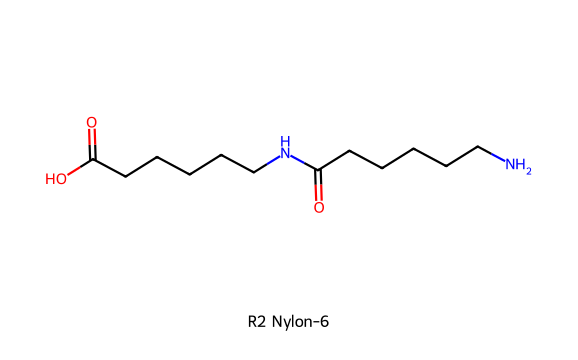

**Mechanism trace:**

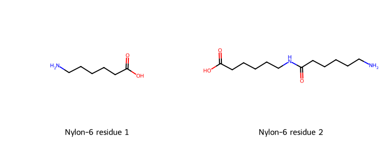

| step | SMILES |
| --- | --- |
| residue 1 | `NCCCCCC(=O)O` |
| residue 2 | `NCCCCCC(=O)NCCCCCC(=O)O` |

## R3 — Poly(ethylene succinate) (PES)

**Family:** Ring-opening  
**Recipe / topology:** ROCOP (5-/6-membered anhydride, C/N/O/S backbone + epoxide; water init.)

| field | value |
| --- | --- |
| mechanism | `R3` |
| family | Ring-opening |
| reaction SMARTS | `[C,c;R:1][C&X3,c;R](=[O&X1])[O&X2,o;R][C&X3,c;R](=[O&X1])[C,c;R:2].[C&X4&R:3]1[O&X2&R:4][C&X4&R:5]1>>([C,c:1][C&X3](=[O&X1])-*.[C,c:2][C&X3](=[O&X1])[O&X2][C&X4:3][C&X4:5][O&X2:4]-*)` |
| registry type | `ring_opening` |
| polymer class | `polyester` |
| practical polymer | Poly(ethylene succinate) (PES) |
| status | known |
| monomer(s) | `O=C1CCC(=O)O1` + `C1CO1` |
| residues / propagation steps | 2 |
| generated product | `O=C(O)CCC(=O)OCCOC(=O)CCC(=O)OCCO` |

Biodegradable ROCOP polyester; the balanced opening consumes one water molecule, the anhydride O becomes the ester O, and the epoxide O becomes the alcohol end.

**Compiled recipe (what the driver runs):**

- `prop_smarts`:
  - `[C&X3:1](=[O:6])([#6:3])[O&X2&H1,Cl,Br,I].[#8,#16;X2;H1;!$([#8,#16][C&X3](=[O,S]));!$([#8,#16][S,P,B,N]);!$([#8,#16][#8]);!$([#8,#16][C&X3]=[C,N]):2]>>[C&X3:1](=[O:6])([#6:3])[O,S&X2:2]`
  - `[C&X3:1](=[O:6])([#6:3])[O&X2][CX4;H3:7].[#8,#16;X2;H1;!$([#8,#16][C&X3](=[O,S]));!$([#8,#16][S,P,B,N]);!$([#8,#16][#8]);!$([#8,#16][C&X3]=[C,N]):2]>>[C&X3:1](=[O:6])([#6:3])[O,S&X2:2]`
- `ring_open_smarts`: `[#6,#7,#8,#16;R;r5,r6:1][C&X3,c;R:10](=[O&X1:11])[O&X2,o;R;r5,r6:3][C&X3,c;R:12](=[O&X1:13])[#6,#7,#8,#16;R;r5,r6:8].[C&X4&R:4]1[O&X2&R:5][C&X4&R:6]1.[O&X2;H2:9]>>([#6,#7,#8,#16:1][C&X3:10](=[O&X1:11])[O&X2:9].[#6,#7,#8,#16:8][C&X3:12](=[O&X1:13])[O&X2:3][C&X4:4][C&X4:6][O&X2:5])`
- `opening_reagents`: `O`

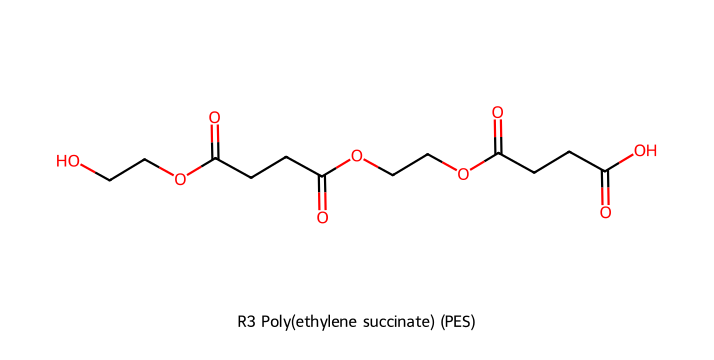

**Mechanism trace:**

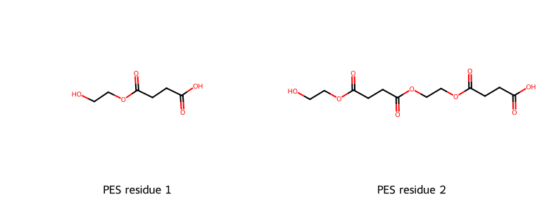

| step | SMILES |
| --- | --- |
| residue 1 | `O=C(O)CCC(=O)OCCO` |
| residue 2 | `O=C(O)CCC(=O)OCCOC(=O)CCC(=O)OCCO` |

## R4 — Poly(ethylene oxide) (PEO)

**Family:** Ring-opening  
**Recipe / topology:** epoxide ROP (direct; 4 regio tiers)

| field | value |
| --- | --- |
| mechanism | `R4` |
| family | Ring-opening |
| reaction SMARTS | `[C&X4;H2,H1,H0;R:1]1[O&R][C&R:2]1>>*-[C&X4:1][C&X4:2]O-*` |
| registry type | `step_growth` |
| polymer class | `polyether` |
| practical polymer | Poly(ethylene oxide) (PEO) |
| status | commercial |
| monomer(s) | `C1CO1` |
| residues / propagation steps | 3 |
| generated product | `OCCOCCO` |

Commodity polyether; water opens the epoxide directly at the less hindered carbon, supplying one -OH end and the epoxide O as the other. Water is the initiator, not an epoxide residue, so length 3 shows two epoxide units (diethylene glycol).

**Compiled recipe (what the driver runs):**

- `coupling_smarts`:
  - `[#8,#16;H1,H2;!$([#8,#16][C&X3](=[O,S]));!$([#8,#16][S,P,B,N]);!$([#8,#16][#8]);!$([#8,#16][C&X3]=[C,N]):1].[C&X4;H2;R:2]1[O&X2&R:3][C&X4;H0,H1;R:4]1>>[#8,#16;X1,X2:1][C&X4:2][C&X4:4][O&X2:3]`
  - `[#8,#16;H1,H2;!$([#8,#16][C&X3](=[O,S]));!$([#8,#16][S,P,B,N]);!$([#8,#16][#8]);!$([#8,#16][C&X3]=[C,N]):1].[C&X4;H1;R:2]1[O&X2&R:3][C&X4;H0,H1;R:4]1>>[#8,#16;X1,X2:1][C&X4:2][C&X4:4][O&X2:3]`
  - `[#8,#16;H1,H2;!$([#8,#16][C&X3](=[O,S]));!$([#8,#16][S,P,B,N]);!$([#8,#16][#8]);!$([#8,#16][C&X3]=[C,N]):1].[C&X4;H2;R:2]1[O&X2&R:3][C&X4;H2;R:4]1>>[#8,#16;X1,X2:1][C&X4:2][C&X4:4][O&X2:3]`
  - `[#8,#16;H1,H2;!$([#8,#16][C&X3](=[O,S]));!$([#8,#16][S,P,B,N]);!$([#8,#16][#8]);!$([#8,#16][C&X3]=[C,N]):1].[C&X4;H0;R:2]1[O&X2&R:3][C&X4;H0;R:4]1>>[#8,#16;X1,X2:1][C&X4:2][C&X4:4][O&X2:3]`
- `reagents`: `O`

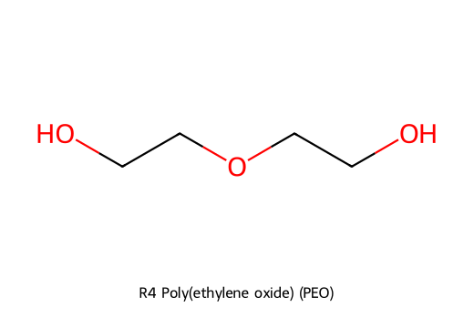

**Mechanism trace:**

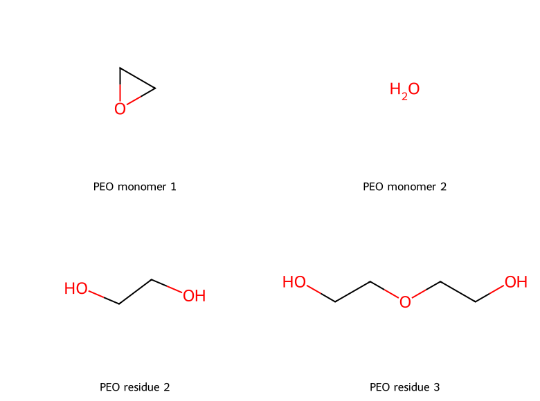

| step | SMILES |
| --- | --- |
| monomer 1 | `C1CO1` |
| monomer 2 | `O` |
| residue 2 | `OCCO` |
| residue 3 | `OCCOCCO` |

## R5 — Poly(norbornene) (PNB, ROMP)

**Family:** Ring-opening  
**Recipe / topology:** ROMP; cuts C=C; joins via C=C

| field | value |
| --- | --- |
| mechanism | `R5` |
| family | Ring-opening |
| reaction SMARTS | `[C&X3&H1&R:1]=[C&X3&H1&R:2][C&X4&R:3]>>(*=[C&X3&H1:1].[C&X3&H1:2]=*)` |
| registry type | `romp` |
| polymer class | `polyolefin` |
| practical polymer | Poly(norbornene) (PNB, ROMP) |
| status | commercial |
| monomer(s) | `C1CC2C=CC1C2` |
| residues / propagation steps | 2 |
| generated product | `C=CC1CCC(C=CC2CCC(C=CC3CCC(C=C)C3)C2)C1` |

Norsorex-type ROMP polymer; the metathesis event cuts the ring C=C, so the new double bonds sit at the junctions between repeat units.

**Compiled recipe (what the driver runs):**

- `ring_bond_smarts`: `[C&X3&H1&R:1]=[C&X3&H1&R:2][C&X4&R:3]>>(*=[C&X3&H1:1].[C&X3&H1:2]=*)`
- `initiator`: `C`
- `terminator`: `C`

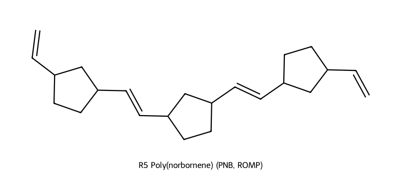

**Mechanism trace:**

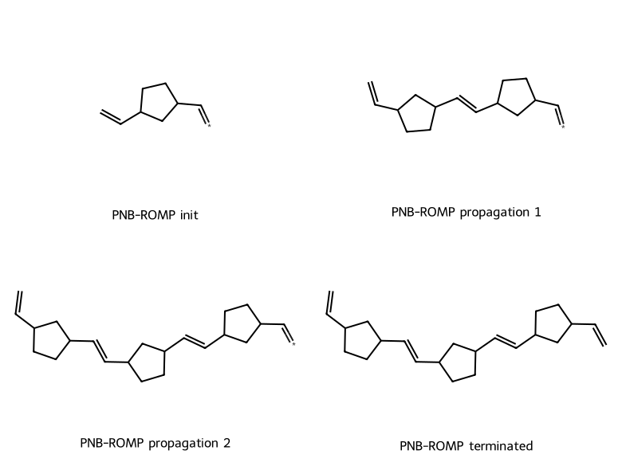

| step | SMILES |
| --- | --- |
| init | `*=CC1CCC(C=C)C1` |
| propagation 1 | `*=CC1CCC(C=CC2CCC(C=C)C2)C1` |
| propagation 2 | `*=CC1CCC(C=CC2CCC(C=CC3CCC(C=C)C3)C2)C1` |
| terminated | `C=CC1CCC(C=CC2CCC(C=CC3CCC(C=C)C3)C2)C1` |

## Generalization checks

These small reactions are executed during generation. The build fails if any observed product/rejection differs from the expected outcome.

| Mechanism | Check | Monomers | Length | Expected | Outcome | Result |
| --- | --- | --- | --- | --- | --- | --- |
| A1 | terminal vinyl propagates head-to-tail | `C=CC` | 2 | product | product | `CCCC(C)CC(C)C` |
| A1 | exocyclic C=C is acyclic and propagates | `C=C1CC(C)(c2cnc[nH]2)C1` | 1 | product | product | `CC1(CC2CC(C)(c3cnc[nH]3)C2)CC(C)(c2cnc[nH]2)C1` |
| A1 | endocyclic C=C does not leak into A1 | `C1CC2C=CC1C2` | 1 | reject | reject | no product |
| A1 | allene/ketene-like cumulene does not match | `C=C=C` | 1 | reject | reject | no product |
| C1 | acid + diol esterification | `O=C(O)c1ccc(C(=O)O)cc1` + `OCCO` | 2 | product | product | `O=C(O)c1ccc(C(=O)OCCO)cc1` |
| C1 | DMT methyl-ester transesterification | `COC(=O)c1ccc(C(=O)OC)cc1` + `OCCO` | 2 | product | product | `COC(=O)c1ccc(C(=O)OCCO)cc1` |
| C7 | PEEK para-ketone activation | `O=C(c1ccc(F)cc1)c1ccc(F)cc1` + `Oc1ccc(O)cc1` | 2 | product | product | `O=C(c1ccc(F)cc1)c1ccc(Oc2ccc(O)cc2)cc1` |
| C7 | para-nitrile activation | `N#Cc1ccc(F)cc1` + `Oc1ccc(O)cc1` | 2 | product | product | `N#Cc1ccc(Oc2ccc(O)cc2)cc1` |
| C7 | PAEN 2,6-difluorobenzonitrile (ortho nitrile) | `Fc1cccc(F)c1C#N` + `Oc1ccc(O)cc1` | 2 | product | product | `N#Cc1c(F)cccc1Oc1ccc(O)cc1` |
| C7 | biphenyl-spaced ketone activation | `O=C(c1ccc(-c2ccc(F)cc2)cc1)c1ccc(-c2ccc(F)cc2)cc1` + `Oc1ccc(O)cc1` | 2 | product | product | `O=C(c1ccc(-c2ccc(F)cc2)cc1)c1ccc(-c2ccc(Oc3ccc(O)cc3)cc2)cc1` |
| C7 | naphthyl-spaced ketone activation | `O=C(c1ccc2cc(F)ccc2c1)c1ccc2cc(F)ccc2c1` + `Oc1ccc(O)cc1` | 2 | product | product | `O=C(c1ccc2cc(F)ccc2c1)c1ccc2cc(Oc3ccc(O)cc3)ccc2c1` |
| C8 | 2,6-disubstituted phenol couples linearly | `Cc1cccc(C)c1O` | 3 | product | product | `Cc1cc(Oc2c(C)cc(Oc3c(C)cccc3C)cc2C)cc(C)c1O` |
| C8 | unblocked ortho positions are rejected | `Oc1ccccc1` | 3 | reject | reject | rejected (ValueError) |
| R3 | succinic anhydride ROCOP | `O=C1CCC(=O)O1` + `C1CO1` | 2 | product | product | `O=C(O)CCC(=O)OCCOC(=O)CCC(=O)OCCO` |
| R3 | diglycolic (heteroatom) anhydride ROCOP | `O=C1COC(=O)O1` + `C1CO1` | 2 | product | product | `O=C(O)COC(=O)OCCOC(=O)COC(=O)OCCO` |

## Generalization scope

The examples on this page are selected by an explicit `mechanism` tag, not by first-match SMARTS discovery, so two templates that match the same monomer do not reroute it. The compiled recipes already include the atom maps and chemoselectivity guards that the registry keys do not show. The remaining limits are monomer-scope choices, not driver defects.

| Area | Classification | Detail |
| --- | --- | --- |
| Alcohol/thiol guards | implemented | `_nucleophile` rejects acyloxy, sulfonic/boronic/phosphoric, oxime/hydroxylamine, peroxide, and enol-ether O-H. |
| Amine guards | implemented | `_amine` rejects amide/imide/thioamide, sulfonamide, and phosphoramide N-H, but allows amidine/thioimidate. A hydrazide N-H is not excluded. |
| C3/C4/C6/R3 atom maps | implemented | The compiled recipes map every reactive centre. C6 consumes phosgene `ClC(=O)Cl`; C4 closes a 5-/6-membered imide ring. |
| R1/R2 cross-matching | not applicable | The drivers receive only the entry selected by its `mechanism` tag. The keys also match cyclic anhydrides/imides, but keys are not used for discovery. |
| A1 acyclic scope | implemented | The compiled template requires a non-ring C=C (`!@`) and `X3` on both carbons. Endocyclic alkenes and allenes/ketenes are rejected; exocyclic vinyls still propagate. |
| A1-A4 regio | implemented for terminal vinyls | Each acyclic unit attaches at its CH2 carbon, giving head-to-tail enchainment. Internal alkenes without a CH2 are not matched. |
| C7 PEEK/PES/PAEN | implemented | NAS queries cover Ar-F/Cl/Br/I with ketone, sulfone, or nitrile activation, either on the halide ring or on a directly attached phenyl or naphthyl spacer. Nitrile activation covers both para and ortho isomers, including the difunctional 2,6-difluorobenzonitrile PAEN monomer. |
| C8 PPO | implemented | Both ortho positions of the coupling ring must be blocked; unsubstituted phenol is rejected and 2,6-disubstituted phenol couples linearly. |
| C1 polyester | implemented | Acid/acyl-halide esterification and methyl-ester transesterification (the DMT route) are supported. Ethyl-ester transesterification is not enabled because it cannot be distinguished safely from backbone esters. |
| R3 ROCOP | implemented | The balanced opening maps all atoms and accepts 5-/6-membered anhydrides with C, N, O, or S ring atoms flanking the carbonyls. |
| A1-A4 dienes | not modelled | Each propagation inserts one C=C. Conjugated 1,4-diene addition is outside the current templates. |
| C5/R4 epoxide regio | implemented | Four compiled tiers include CH2/CH2 and CH0/CH0, so ethylene oxide and fully substituted epoxides match. |

